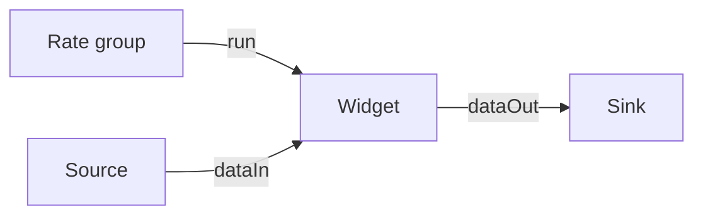
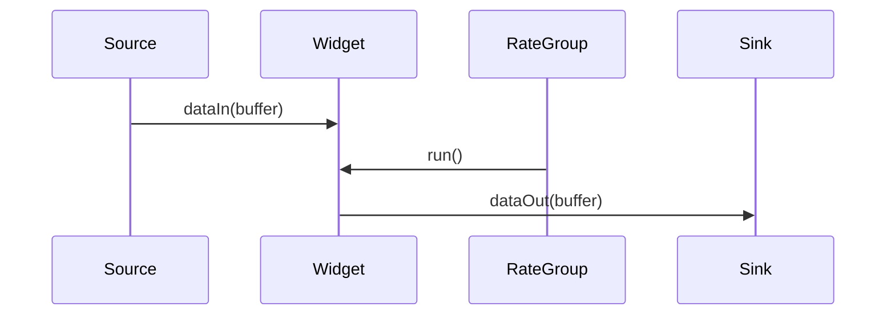

# Svc::Widget Component

## 1. Introduction

The `Svc::Widget` demonstrates the checklist checks. It is an active component
driven by a rate group.

## 2. Requirements

Requirement | Description | Kind | Parent | Verification Method
----------- | ----------- | ---- | ------ | -------------------
WID-001 | The `Svc::Widget` component shall START and STOP processing on command | Behavior | SYS-010 | Unit Test
WID-002 | The `Svc::Widget` component shall report the WidgetCount telemetry channel | Output | SYS-011 | Unit Test
WID-003 | The `Svc::Widget` component shall emit WidgetStarted and WidgetError events | Output | SYS-011 | Unit Test
WID-004 | The `Svc::Widget` component shall use the THRESHOLD parameter | Input | SYS-012 | Analysis
WID-005 | The `Svc::Widget` component shall produce WidgetRecord into WidgetContainer and OrphanContainer via productSendOut and productRequestOut | Output | SYS-013 | Unit Test
WID-006 | The `Svc::Widget` component shall accept data on dataIn, run on the run port, and forward via dataOut, cmdIn, cmdRegOut, cmdResponseOut, eventOut, tlmOut, timeGetOut, prmGetOut, prmSetOut, productRecvIn | Input | SYS-014 | Inspection
WID-007 | The `Svc::Widget` component shall allow SET_PRIORITY to change data product priority | Behavior | | Unit Test
WID-008 | The `Svc::Widget` component shall process each dataIn buffer within one rate-group cycle | Performance | SYS-015 | Unit Test
WID-009 | The `Svc::Widget` component shall buffer at most one pending dataIn buffer | Memory | SYS-016 | Unit Test

Hardware I/O requirements: N/A (the widget has no hardware interface).

## 3. Design

The design covers WID-001, WID-002, WID-003, WID-004, WID-005, WID-006, WID-008, and WID-009.

### 3.1 Block diagram

### 3.2 Ports

| Port | Kind | Type | Description |
|------|------|------|-------------|
| run | async input | Svc.Sched | Rate group input |
| dataIn | sync input | Fw.BufferSend | Data input |
| dataOut | output | Fw.BufferSend | Data output |

### 3.3 Behavior

On each `run` invocation the widget forwards the pending buffer received on
`dataIn` to `dataOut`, following the `DeviceSm` state machine (IDLE/RUNNING).

### 3.4 Sequence diagrams

### 3.5 Commands

| Mnemonic | Description |
|----------|-------------|
| START | Start processing |
| STOP | Stop processing |
| SET_PRIORITY | Set data product priority |

### 3.6 Telemetry

| Channel | Type | Description |
|---------|------|-------------|
| WidgetCount | U32 | Buffers forwarded |

### 3.7 Events

| Event | Severity | Description |
|-------|----------|-------------|
| WidgetStarted | activity high | Widget started |
| WidgetError | warning high | Widget error |

### 3.8 Parameters

| Parameter | Type | Default |
|-----------|------|---------|
| THRESHOLD | U32 | 10 |

### 3.9 Data products

| Record / Container | Description |
|--------------------|-------------|
| WidgetRecord | Forwarded count |
| WidgetContainer | Default container, priority 10 |
| OrphanContainer | Container without default priority |

## 4. External interfaces

External interfaces: None.
